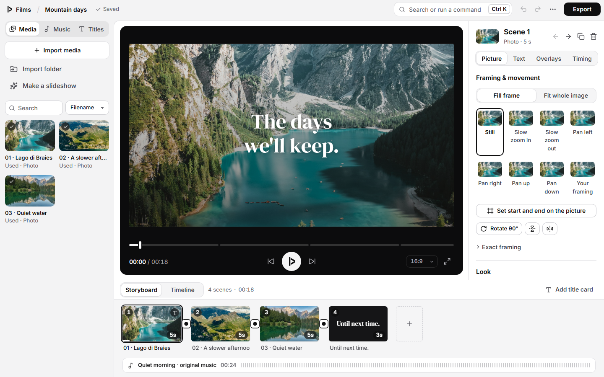

<!-- keel:start -->
<p align="left"></p>

# Small films. Lasting memories.

Corto is a home video and slideshow maker for **Windows, macOS, Linux and the web**. Turn photos, short clips, music and a few words into a film worth keeping. No account, media upload, OneDrive requirement, subscription or watermark.

[Open the web app](https://itsdanielyc.github.io/corto/) � [Desktop previews](https://github.com/itsdanielyc/corto/releases) � [Installation guide](docs/installing.md)



## Make a little movie

1. Import photos, clips or music. Visual media goes straight into the storyboard.
2. Reorder scenes, trim clips, split or duplicate moments, and undo freely.
3. Add titles and timed subtitles. Place songs, record narration and choose fades or reduced music under clip sound.
4. Export in landscape, portrait or square with TV, phone or small-file presets; try a five-second sample first.

Desktop builds export local H.264/AAC MP4 files using a bundled, checksum-verified FFmpeg executable. The browser offers MP4 recording where its encoder is supported; other browsers can transfer a portable project to the desktop app. Keep the tab visible during web export.

## Your projects stay with you

The editor autosaves named films on this device. **My films** shows recent projects and can recover the previous edit as a separate copy. **Save portable copy** writes a self-contained `.corto` project with its original media, so it can move between computers and operating systems without relinking files. Keep portable copies of projects you want to preserve, especially when using browser storage.

The application contains no accounts, analytics, remote fonts or media upload service. The example and its credited photos/music are bundled locally. The production web shell can cache itself for offline use after the first successful load.

## Preview scope

- Native Windows x64, Apple Silicon and Intel Mac, Linux x64; responsive browser editor.
- JPG, PNG, WebP, BMP and HEIC/HEIF photos; MP4/MOV/WebM video, with local HEVC/HDR compatibility copies; MP3, WAV, M4A, AAC, FLAC and Ogg audio.
- Up to 30 minutes, 300 scenes, 500 originals and 8 GB of media per project; 2 GB per original.
- A single storyboard, placed songs/narration and timed subtitles. HEIF decoding is bounded to 64 megapixels; browser phone-video conversion to 256 MB; narration to five-minute sections. Originals remain unchanged. General RAW/professional HDR editing, automatic transcription, native mobile installers and automatic updates are outside this preview.
- Desktop installers are **unsigned**. Read the [OS installation notes](docs/installing.md).

## Build and contribute

Use Node.js 24 and npm. Dependency installation verifies the native media engine against the committed upstream SHA-256 before executing it.

```sh
npm ci
npx playwright install chromium
node node_modules/electron/install.js
npm run dev                 # desktop editor
npm run dev:web             # real browser editor
npm run build               # native application
npm run build:web           # static web app + offline cache
npm run package             # installer for the current OS
```

```sh
npm run typecheck
npm run test:unit
npm run test:integration     # real files + actual encoded movies
npm run test:ui              # browser journeys, accessibility and visuals
npm run test:e2e             # built native app, including a full editing/export journey
npm run test:web             # production build offline check, after build:web
```

Read [AGENTS.md](AGENTS.md), [architecture](ARCHITECTURE.md), [test strategy](TESTING.md), [verification ledger](VERIFICATION.md) and [project format](docs/project-format.md). Every support claim needs a level, platform and named run. Hosted runners capture pixel baselines; the installer gate blocks premature releases.

Application code is MIT-licensed. FFmpeg and other dependencies retain their own licences; see [third-party notices](THIRD_PARTY_NOTICES.md) and [example credits](public/demo/CREDITS.md). Corto/miille brand assets do not grant trademark rights.
<!-- keel:end -->

<details><summary>Original Keel scaffold provenance</summary>

# Corto

Generated by Keel from the `electron-web` template. Start with AGENTS.md.

## Commands

```bash
npm install
npm run test:unit
npm run test:ui        # Playwright, chromium, against the labelled mock
npm run build          # main, preload and renderer into out/ for the real-shell suite
npm run test:e2e       # Playwright's Electron launcher against the built app
```

</details>
